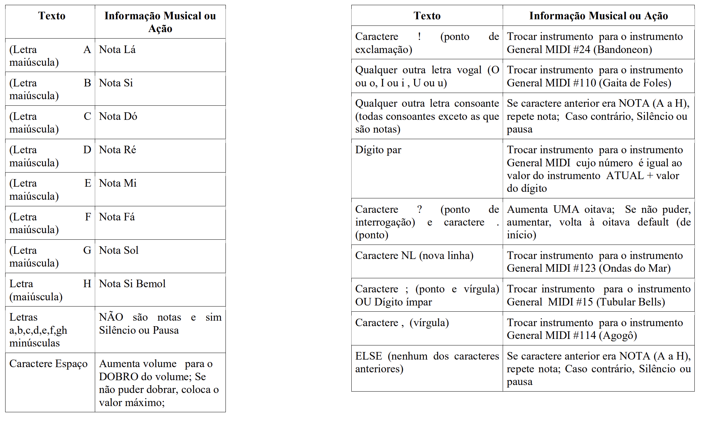
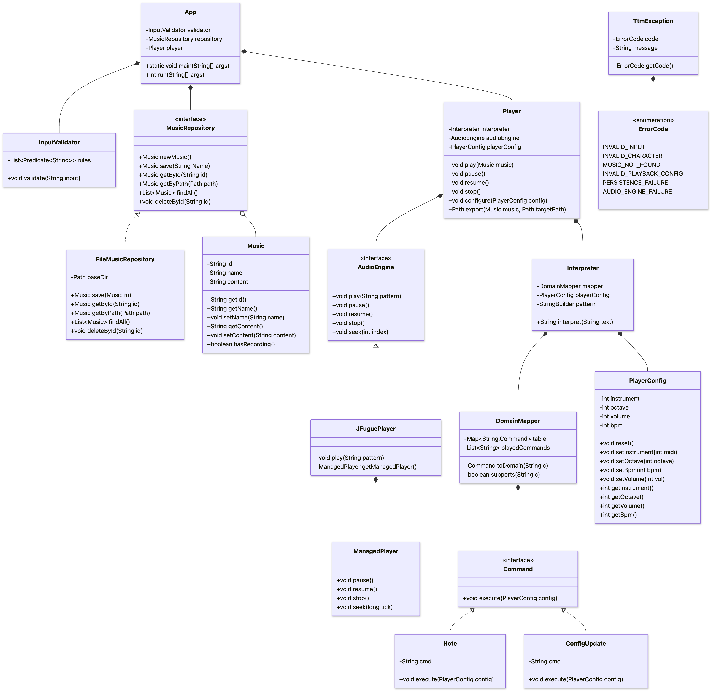
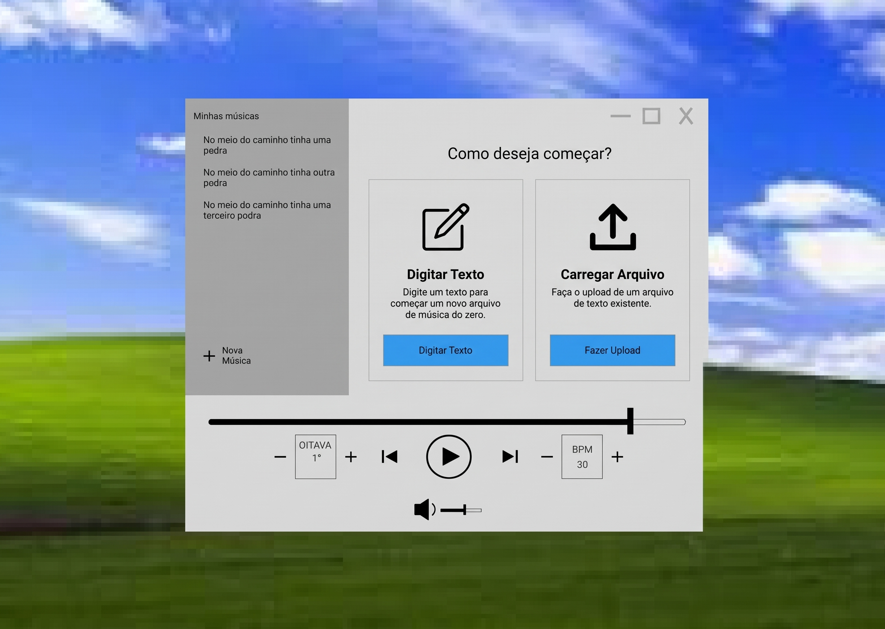

# Trabalho Pr√°tico INF01120 - Desenvolvimento de Software

## Autores
- André Schaidhauer Luckmann;
- Arthur Von Groll dos Santos;
- Carlos Eduardo Boesel Morari;
- Giovani Ferreira de Alencoi.

## TTM - (Text-To-Music)

O projeto consiste em um **gerador de sequências musicais a partir de um texto de entrada**. O sistema recebe um arquivo de texto e, com base em regras de mapeamento,
produzirá uma sequência de notas musicais que poderá ser reproduzida pelo JFugue. Os parâmetros são definidos através de um mapeamento de texto para informações musicais.

## Lista de Requisitos

### Lista de Requisitos Funcionais

1. Ao iniciar, o sistema exibe a lista de músicas salvas ("Minhas músicas") e permite criar uma nova música a partir do upload de um arquivo `.txt` ou da digitação/colagem direta em um campo de texto na interface.
2. O sistema interpreta o texto-fonte **caractere por caractere**, aplicando a seguinte tabela de mapeamento:

3. O usu√°rio pode selecionar uma m√∫sica da lista para reproduzi-la.
4. O usu√°rio pode controlar o playback ao vivo: play, pause, resume, stop e navegar pela m√∫sica.
5. O usuário pode configurar parâmetros musicais da reprodução: BPM, oitava, volume e instrumento inicial.
6. O usu√°rio pode renomear e deletar uma m√∫sica salva.
7. O usu√°rio pode exportar a m√∫sica interpretada como arquivo em um caminho do filesystem local de sua escolha.

<!-- Fora de escopo Fase 1, mantidos como referência para fases futuras:
- Modo interativo por teclado (pressionar teclas toca instantaneamente).
- Destaque visual do trecho corrente durante o playback (sincronizado com a reprodução).
-->

### Lista de Requisitos N√£o Funcionais

1. **Modularidade por responsabilidade:** O código é organizado em módulos coesos alinhados ao diagrama de classes: entrada e validação (`InputValidator`), persistência (`MusicRepository` + `FileMusicRepository`), interpretação e mapeamento (`Interpreter` + `DomainMapper` + `Command`), execução de áudio (`Player` + `AudioEngine` + `JFuguePlayer`) e composição da aplicação (`App`). Interfaces isolam detalhes trocáveis (motor de áudio, meio de persistência).
2. **Tratamento de erros centralizado:** Erros de domínio são modelados por uma única hierarquia de exceptions e códigos internos, sem stack traces vazando para a UI.
3. **Testabilidade:** Cada módulo será coberto por testes unitários para garantir o funcionamento correto.
4. **Padronização de estilo automática.** Usaremos ferramentas de Linters para garantir a padronização do estilo do código entre membros da equipe.
5. **Repositório GitHub e fluxo de PR.** Toda mudança deverá passar por revisão por pares dos membros do grupo para evitar a introdução de bugs e garantir a distribuição de conhecimento do código entre a equipe.
6. **Pipeline CI/CD.** Usaremos pipelines de CI/CD para build automático de artefatos, checar qualidade de código e evitar bad smells e executar testes que garantem integridade a cada entrega.

## DocumentaÁ„o TÈcnica (Fase 2)

A documentaÁ„o detalhada da Fase 2 est· organizada na pasta [docs/](docs/):
- [**DocumentaÁ„o de ImplementaÁ„o da Fase 2**](docs/FASE2_IMPLEMENTACAO.md): resumo das 4 mudanÁas, pacotes, classes, CLI e qualidade.
- [**Arquitetura e PrincÌpios SOLID**](docs/ARQUITETURA.md): vis„o de camadas, padrıes de projeto e prevenÁ„o de bad smells.
- [**Mapa de Comandos**](docs/MAPA_DE_COMANDOS.md): tabela de referÍncia para notas, acidentes, duraÁıes, polifonia e par‚metros.
- [**Diagrama de Classes Mermaid**](design/diagram.mmd): modelo estrutural completo e atualizado.

## Diagrama de Classes

### Princípios SOLID

Cada princípio SOLID citado no enunciado é aplicado da seguinte forma na arquitetura do programa:

- **S - Single Responsability:** Cada classe tem uma única responsabilidade para mudar. `Interpreter` só interpreta arquivos de texto para Patterns do JFugue; `Player` gerencia a s ações relacionadas a tocar uma música; `DomainMapper` mapeia os valores de entrada para comandos a serem executados; `FileMusicRepository` gerencia o sistema de repositório de músicas em sistema de arquivos; `AudioEngine` se encarrega de emitir os sons tocados pelo player. Uma mudança em uma dessas classes não deve afetar o funcionamento das outras.
- **O - Open/Closed:** Novas regras de mapeamento são adicionadas criando uma nova implementação de `Command` e registrando-a no `DomainMapper.table`, **sem modificar** `Interpreter` nem `Player`. Novos formatos de saída são adicionados implementando `AudioEngine`, sem tocar no domínio. Novas regras de validação são adicionadas a lista do `InputValidator`.
- **L - Substituição de Liskov:** `Interpreter` opera sobre `Command.execute(PlayerConfig)` sem saber se o `Command` é `Note` ou `ConfigUpdate`. Toda `AudioEngine` é substituível: `JFuguePlayer` pode ser trocada por implementação mock em testes sem alterar `Player`.
- **I - Segregação de Interfaces:** Interfaces são pequenas e específicas: `Command` (um método), `MusicRepository` (CRUD focado em `Music`), `AudioEngine` (contrato de playback). Nenhuma classe é forçada a implementar métodos que não usa.
- **D - Inversão de Dependência:** `App` e `Player` dependem das abstrações `MusicRepository` e `AudioEngine`, não das classes concretas `FileMusicRepository` e `JFuguePlayer`. A composição é feita no `App`, permitindo trocar backend de persistência ou motor de áudio via injeção.

## Croquis de Interface

### Tela 1

### Tela 2

### Tela 3

### Tela 4

O design segue uma estética de interface única, controles nativos familiares (player bar, botões `+/−`, ícone de volume), e barras laterais em todas as telas com as músicas carregadas, a área central serve para a edição, upload e reprodução de música.

### Tela 1 — Nova Música: escolha do método de entrada

Ao abrir o programa, o usuário pode escolher criar uma nova música ou fazer o upload de algum arquivo de texto já existente. Ambas as opções levam para a Tela 2, que é a tela de edição do arquivo escolhido.

### Tela 2 — Editor / Revisor de texto com salvar

Após a escolha da Tela 1, o painel direito vira uma **área de texto editável** exibindo o conteúdo (digitado do zero ou carregado de arquivo `.txt`) com barra de rolagem, e um botão **"salvar"** ancorado no topo direito. Ao clicar em salvar, o usuário deverá escolher um local no sistema de arquivos para salvar o arquivo da música. A sidebar permanece à esquerda para que o usuário possa abandonar a criação clicando em uma música existente.

### Tela 3 — Menu de contexto na sidebar

Clicar com o botão direito sobre um item da lista "Minhas músicas" abre um menu de contexto flutuante com três ações: **renomear**, **deletar** e **exportar música**. O menu aparece ancorado ao item clicado, deixando claro **qual** música será afetada (a linha selecionada fica destacada), o que reduz o risco de deleção equivocada. Renomear e deletar abrirão diálogos modais em etapa subsequente, e exportar dispara o seletor de arquivos.

### Tela 4 — Player em reprodução com destaque do trecho corrente

Durante a reprodução, o painel direito exibe o texto-fonte completo em modo somente-leitura e **destaca o trecho corrente em vermelho** sincronizado com o áudio.

