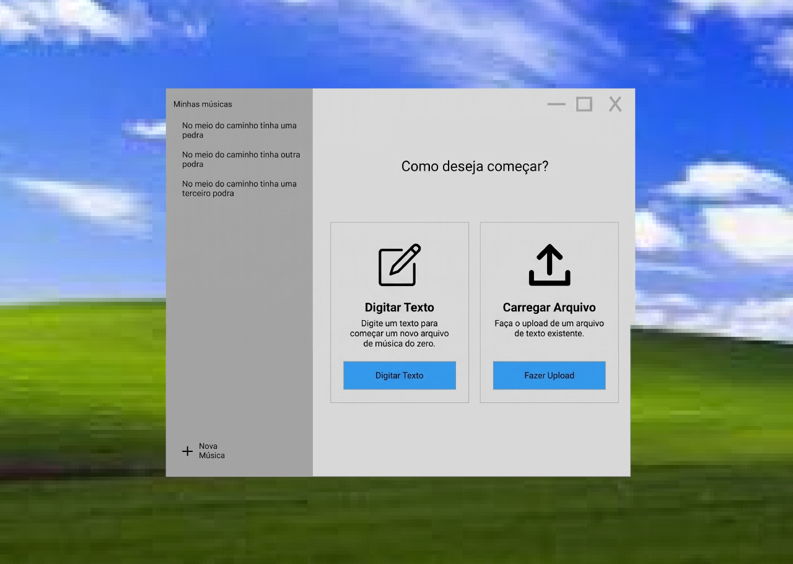
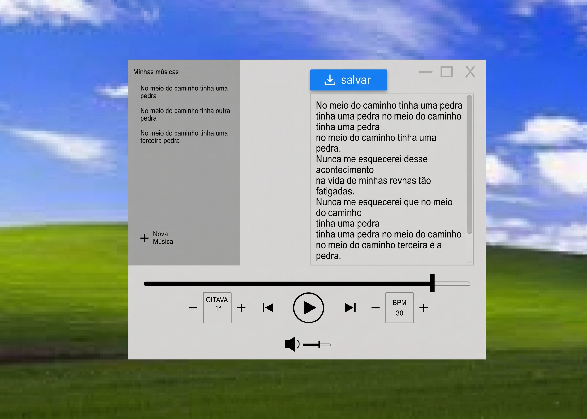
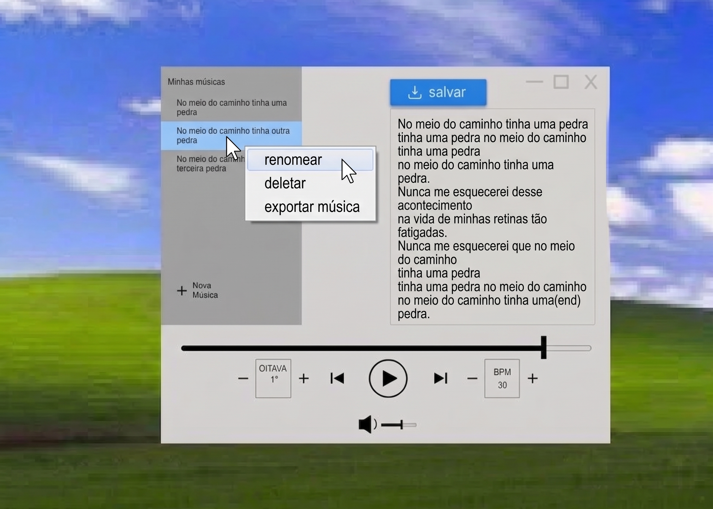
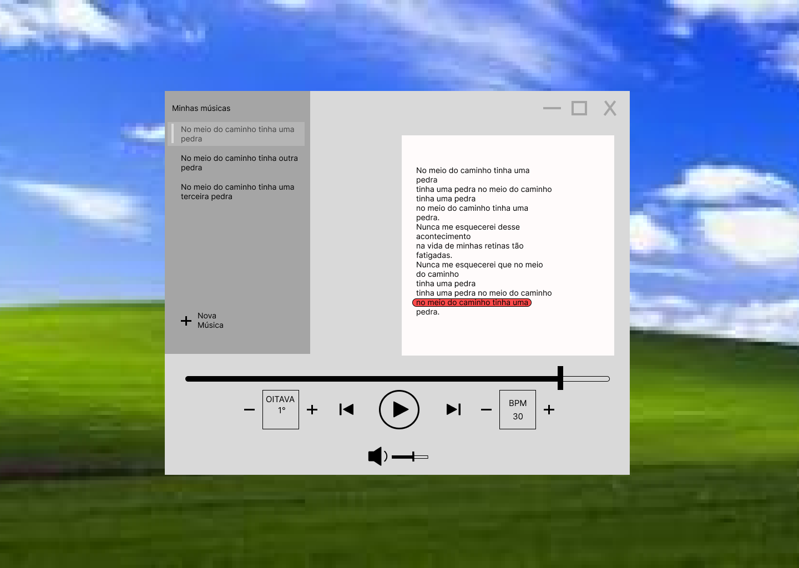

# Trabalho Prático INF01120 - Desenvolvimento de Software

**Grupo 1**

## Autores
- André Schaidhauer Luckmann;
- Arthur Von Groll dos Santos;
- Carlos Eduardo Boesel Morari;
- Giovani Ferreira de Alencoi.

## TTM - (Text-To-Music)

O projeto consiste em um **gerador de sequências musicais a partir de um texto de entrada**. O sistema recebe um arquivo de texto e, com base em regras de mapeamento,
produzirá uma sequência de notas musicais que poderá ser reproduzida pelo JFugue. Os parâmetros são definidos através de um mapeamento de texto para informações musicais.

## Lista de Requisitos

### Requisitos Funcionais (RF)

> A interface gráfica dos croquis está implementada em Swing (ver [Interface Gráfica](docs/INTERFACE_GRAFICA.md)).

1. **RF01 — Biblioteca e entrada:** listar músicas, criar por digitação e importar arquivo TXT.
2. **RF02 — Salvar origem:** ao editar música importada, sobrescrever o TXT original sem apagá-lo ao remover a cópia da biblioteca.
3. **RF03 — Interpretação:** mapear o texto caractere a caractere, com notas A–G, acidentes, sete durações, quatro vozes polifônicas, atraso e parâmetros por voz. A tabela completa está no [Mapa de Comandos](docs/MAPA_DE_COMANDOS.md).
4. **RF04 — Reprodução:** tocar, pausar, retomar, parar, navegar e destacar o trecho corrente sem permitir edição durante o playback.
5. **RF05 — Configuração:** ajustar BPM global, oitava e volume; aplicar instrumentos-base distintos às vozes e trocá-los por comandos do texto.
6. **RF06 — MIDI:** exportar MIDI válido no nome e diretório escolhidos pelo usuário, com confirmação antes de substituir um arquivo existente.
7. **RF07 — Biblioteca:** renomear e deletar a cópia local de uma música.

### Requisitos Não Funcionais (RNF)

1. **RNF01 — Modularidade:** módulos coesos e dependências por interfaces para áudio e persistência.
2. **RNF02 — Erros:** exceções de domínio e mensagens controladas na interface.
3. **RNF03 — Testabilidade:** testes automatizados para domínio, persistência, presenter, MIDI e regras de mapeamento.
4. **RNF04 — Qualidade:** Spotless, Checkstyle, SpotBugs, JaCoCo e CI executados por mvn verify.
5. **RNF05 — Manutenibilidade:** repositório Git, histórico de PRs e documentação de arquitetura, comandos e interface.

## Documentação Técnica (Fase 2)

A documentação detalhada da Fase 2 está organizada na pasta [docs/](docs/):
- [**Documentação de Implementação da Fase 2**](docs/FASE2_IMPLEMENTACAO.md): resumo das 4 mudanças, pacotes, classes e qualidade.
- [**Arquitetura e Princípios SOLID**](docs/ARQUITETURA.md): visão de camadas, padrões de projeto e prevenção de bad smells.
- [**Mapa de Comandos**](docs/MAPA_DE_COMANDOS.md): tabela de referência para notas, acidentes, durações, polifonia e parâmetros.
- [**Diagrama de Classes Mermaid**](design/diagram.mmd): modelo estrutural completo das classes próprias do projeto.
- [**Interface Gráfica (Swing)**](docs/INTERFACE_GRAFICA.md): como executar, telas, Clean Architecture e padrões de projeto da GUI.

## Diagrama de Classes (fonte Mermaid)

O diagrama editável está em [design/diagram.mmd](design/diagram.mmd).

### Princípios SOLID

Cada princípio SOLID citado no enunciado é aplicado da seguinte forma na arquitetura do programa:

- **S - Single Responsibility:** Cada classe tem uma única responsabilidade para mudar. `Interpreter` só interpreta arquivos de texto para Patterns do JFugue; `Player` coordena reprodução e exportação MIDI; `DomainMapper` mapeia os valores de entrada para comandos a serem executados; `FileMusicRepository` gerencia o sistema de repositório de músicas em sistema de arquivos; `AudioEngine` se encarrega de emitir os sons tocados pelo player. Uma mudança em uma dessas classes não deve afetar o funcionamento das outras.
- **O - Open/Closed:** Novas regras de mapeamento são adicionadas criando uma nova implementação de `Command` e registrando-a no `DomainMapper.table`, **sem modificar** `Interpreter` nem `Player`. Novos formatos de saída são adicionados implementando `AudioEngine`, sem tocar no domínio. Novas regras de validação são adicionadas a lista do `InputValidator`.
- **L - Substituição de Liskov:** `Interpreter` opera sobre `Command.execute(PlayerConfig)` sem saber se o `Command` é `Note` ou `ConfigUpdate`. Toda `AudioEngine` é substituível: `JFuguePlayer` pode ser trocada por implementação mock em testes sem alterar `Player`.
- **I - Segregação de Interfaces:** Interfaces são pequenas e específicas: `Command` (um método), `MusicRepository` (CRUD focado em `Music`), `AudioEngine` (contrato de playback). Nenhuma classe é forçada a implementar métodos que não usa.
- **D - Inversão de Dependência:** `App` depende de `MusicRepository` e `Player` depende de `AudioEngine`, não das classes concretas `FileMusicRepository` e `JFuguePlayer`. A composição é feita no `App`, permitindo trocar backend de persistência ou motor de áudio via injeção.

## Croquis de Interface

As imagens abaixo são os protótipos que guiaram a interface Swing. Para executar a GUI, rode `com.player.App` sem argumentos (detalhes em [docs/INTERFACE_GRAFICA.md](docs/INTERFACE_GRAFICA.md)).

### Tela 1

### Tela 2

### Tela 3

### Tela 4

O design segue uma estética de interface única, controles nativos familiares (player bar, botões `+/−`, ícone de volume), e barras laterais em todas as telas com as músicas carregadas, a área central serve para a edição, upload e reprodução de música.

### Tela 1 — Nova Música: escolha do método de entrada

Ao abrir o programa, o usuário pode escolher criar uma nova música ou fazer o upload de algum arquivo de texto já existente. Ambas as opções levam para a Tela 2, que é a tela de edição do arquivo escolhido.

### Tela 2 — Editor / Revisor de texto com salvar

Após a escolha da Tela 1, o painel direito vira uma **área de texto editável** com barra de rolagem e botão **"salvar"**. Textos criados ficam na biblioteca local; textos importados também atualizam o arquivo TXT de origem. A sidebar permanece à esquerda para que o usuário possa abandonar a criação clicando em uma música existente.

### Tela 3 — Menu de contexto na sidebar

Clicar com o botão direito sobre um item da lista "Minhas músicas" seleciona o item e abre um menu de contexto com **renomear**, **deletar** e **exportar música**. Cliques em área vazia não abrem o menu, reduzindo o risco de ação na música errada.

### Tela 4 — Player em reprodução com destaque do trecho corrente

Durante a reprodução, o painel direito exibe o texto-fonte completo em modo somente-leitura e **destaca o trecho corrente em vermelho** sincronizado com o áudio.

